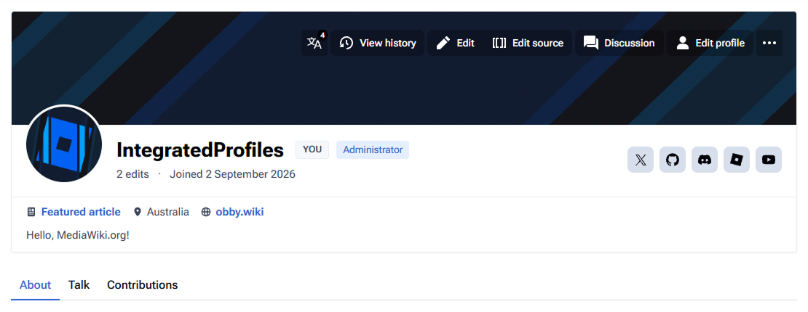
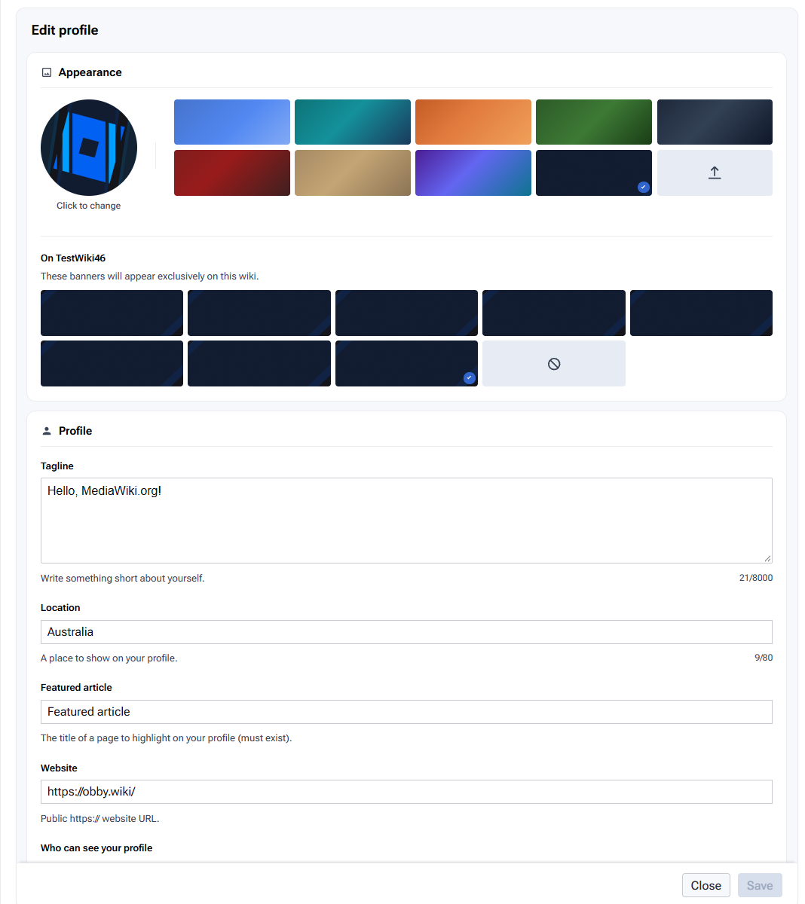
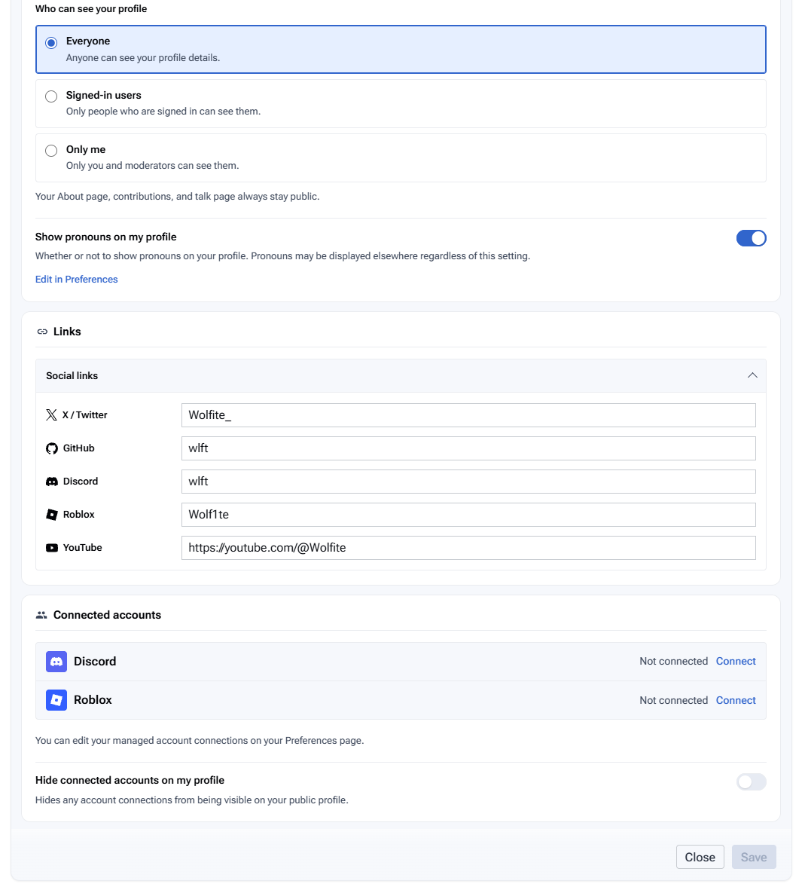
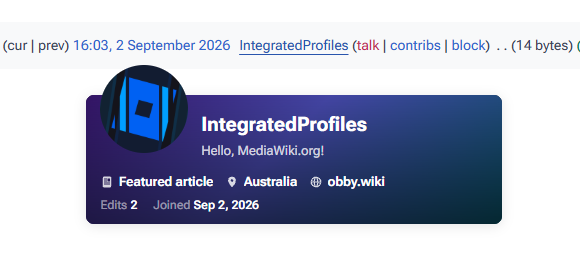

# IntegratedProfiles (Usage)


> Screenshot taken on the Citizen skin while using IntegratedProfiles v0.5.0.

> [!WARNING]
> IntegratedProfiles is currently in BETA.

IntegratedProfiles implements modern and extensible user profiles with the added focus of integration, meaning any other extension can add onto it.

## Screenshots

<details>
  <summary>Profile Editor</summary>

> Taken on IntegratedProfiles v0.6.0 using the Citizen skin (with NewAuth active).

  

  
</details>

<details>
  <summary>User Cards</summary>

> Taken on IntegratedProfiles v0.6.0 using the Citizen skin.

  
</details>

## Installation

### Requirements

* MediaWiki 1.45 or later
  * Only MW 1.45 and MW 1.46 have been tested. Earlier versions may work but are not officially supported.
  * The extensions currently works on MW 1.44, but is not officially targeted and is not guaranteed to work with future updates.

### Suggestions

* [Extension:FloatingUI](https://www.mediawiki.org/wiki/Extension:FloatingUI)
* An image library for WebP thumbnails, any of: [libvips](https://www.libvips.org) (`vipsthumbnail`, recommended), the PHP `imagick` extension, or PHP `gd` with WebP support.
* Any Codex-compatible skin[^1], or one of the following skins for the best results:
  * [Citizen](https://www.mediawiki.org/wiki/Skin:Citizen) (built-in improvements)
  * Vector 2022

### Install

1. Clone into `extensions/IntegratedProfiles`
2. Files are bundled with-in the repo, but, optionally, you can rebuild them manually: `pnpm install && pnpm build`
3. Load in `LocalSettings.php`:

```php
wfLoadExtension( 'IntegratedProfiles' );
```

## Setup

By default, avatars and banners are stored under `{UploadDirectory}/ipavatars` and `{UploadDirectory}/ipbanners` (usually `$IP/images/...`), as `avatar_{id}.{ext}` and `banner_{id}.{ext}`. Generated thumbnails go in the sibling `ipavatars-thumbs` and `ipbanners-thumbs` containers, as `{id}/{version}/{size}.webp`. The version changes whenever the original is replaced, so thumbnail URLs can be cached as immutable. Profile fields (prefixed with `ip-`) are stored in `user_properties` (preferences). IntegratedProfiles does not touch wikitext, contributions, or anything else.

The `{id}` in those filenames comes from CentralIdLookup, which is either the local user id or the central (`gu_id`) id when CentralAuth is installed.

See below for the required/recommended setup based on your architecture.

### Mutual setup

This setup applies to every setup. If you have not installed FloatingUI, I recommend that you do:

```php
wfLoadExtension( 'FloatingUI' ); # Provides tooltip feedback for certain UI actions (and also enhances mobile support, as users can tap a social link to preview it with a tooltip before opening it).
```

### Single wiki

No extra configuration is needed. The default backend is enough, so simply load the extension:

```php
wfLoadExtension( 'IntegratedProfiles' );
```

Ensure that `$IP/images/ipavatars`, `$IP/images/ipbanners`, `$IP/images/ipavatars-thumbs` and `$IP/images/ipbanners-thumbs` are writable (or that `$IP/images` is, so they can be created). You can configure a custom FileBackend if you wish, however.

### Wiki farm

You should follow this if you use `CentralAuth`, regardless if you are a farm or not.

Requirements:

* CentralAuth (or another `CentralIdLookup` provider). Using shared user tables instead will (likely) not work.
* Shared file storage.
* The GlobalPreferences extension.

#### Separate upload directories

Register one FileBackend that defines all four containers with a constant `domainId`. Paths must resolve to the same storage from every wiki (NFS, a shared volume, or equivalent). Then set `$wgIntegratedProfilesBackend` to that name:

```php
wfLoadExtension( 'CentralAuth' );
wfLoadExtension( 'GlobalPreferences' );
$wgGlobalPreferencesDB = '...';
wfLoadExtension( 'IntegratedProfiles' );

$wgFileBackends[] = [
	'name' => 'ip-shared',
	'class' => \Wikimedia\FileBackend\FSFileBackend::class,
	'domainId' => 'ip-farm', // must be identical on every wiki
	'lockManager' => 'nullLockManager',
	'containerPaths' => [
		'ipavatars' => $IP . '/images/ipavatars',
		'ipbanners' => $IP . '/images/ipbanners',
		'ipavatars-thumbs' => $IP . '/images/ipavatars-thumbs',
		'ipbanners-thumbs' => $IP . '/images/ipbanners-thumbs',
	],
	'fileMode' => 0644,
];
$wgIntegratedProfilesBackend = 'ip-shared';
$wgIntegratedProfilesUploadBaseUrl = 'https://static.example.com/images';
```

`$wgIntegratedProfilesUploadBaseUrl` is the public URL every wiki should use for avatars and banners. Do not include ipavatars/ipbanners (or their `-thumbs` containers), as those are appended automatically. Set this when wikis have different hosts or a wiki-local `$wgUploadPath` (often including `$wgDBname`). Leave it empty on a single wiki.

Backends configured before thumbnails existed only list `ipavatars` and `ipbanners`. Add the two `-thumbs` containers, otherwise no thumbnails can be stored on that backend. Avoid placing them under core's `thumb/` directory, since `thumb_handler.php` rewrites will intercept requests there.

#### Shared `$wgUploadDirectory`

If every wiki already uses the same upload directory (one `images/` volume), leave `$wgIntegratedProfilesBackend` empty. The default backend uses a stable domain id (`integratedprofiles`), so media is shared without a designated backend. You still need CentralAuth and GlobalPreferences:

```php
wfLoadExtension( 'CentralAuth' );
wfLoadExtension( 'GlobalPreferences' );
$wgGlobalPreferencesDB = '...';
wfLoadExtension( 'IntegratedProfiles' );
```

<!--### Initial setup

If you are using CentralAuth, you should configure a file backend for IntegratedProfiles, including a place for both `ipavatars` and `ipbanners`. This is recommended for expected behavior, and also enables global avatars and banner uploads (truly global banners require GlobalPreferences, see below).

```php
$wgFileBackends[] = [
	'name' => 'ip-shared',
	'class' => \Wikimedia\FileBackend\FSFileBackend::class,
	'domainId' => 'any-domain-id',
	'lockManager' => 'nullLockManager',
	'containerPaths' => [
		'ipavatars' => $IP . '/images/ipavatars',
		'ipbanners' => $IP . '/images/ipbanners',
	],
	'fileMode' => 0644,
];

$wgIntegratedProfilesBackend = 'ip-shared';
```

If CentralAuth is present, files will be stored as `<folder>/central-id`, otherwise `<folder>/local-id`.-->

### Global preferences

This extension is compatible with `GlobalPreferences`. Consider installing this extension alongside IntegratedProfiles, like so:

```php
wfLoadExtension( 'GlobalPreferences' );

$wgGlobalPreferencesDB = '...';
```

See [Extension:GlobalPreferences](https://www.mediawiki.org/wiki/Extension:GlobalPreferences) for more information.

### Suggested extensions

The following extensions are used by IntegratedProfiles in order to achieve full functionality:

```php
wfLoadExtension( 'FloatingUI' ); # Provides tooltip feedback for certain UI actions (and also enhances mobile support, as users can tap a social link to preview it with a tooltip before opening it).
wfLoadExtension( 'CentralAuth' );
wfLoadExtension( 'GlobalPreferences' );
```

## Integrations

Integrations are the whole point of IntegratedProfiles!

### Built-in integrations

IntegratedProfiles integrates certain functionalities from NewAuth. If you have access to NewAuth and have the extension loaded and properly configured, it should work correctly without any configuration. If it does not, please contact me.

### External integrations

Below are open-source integrations that implement IntegratedProfiles' hooks or APIs:

* Extension:UserFlairs

> You can add any open-source integrations to this list in a PR, if you want.

## Configuration

| Config | Type(s) | Default | Purpose |
|--------|---------|---------|---------|
| `$wgIntegratedProfilesGroupPriority` | array | `['sysop','bureaucrat','interface-admin','checkuser','oversight','steward']` | Role IDs to show first in the profile header, as roles that do not fit may be collapsed. Keep the most important roles in the first three items. |
| `$wgIntegratedProfilesBackend` |  | `''` | Named entry in `$wgFileBackends`. Empty uses `{UploadDirectory}/ipavatars`, `{UploadDirectory}/ipbanners`, and their `-thumbs` siblings. Must already exist if set, and should define all four containers. See Setup. |
| `$wgIntegratedProfilesUploadBaseUrl` |  | `''` | Stable public URL root for avatars and banners. Do not include `ipavatars`/`ipbanners`. When empty, defaults to `$wgUploadBaseUrl` + `$wgUploadPath`. |
| `$wgIntegratedProfilesCacheType` | int / string / null | `null` | Object cache for avatar and banner file metadata. When null, $wgMainCacheType is used, otherwise IP uses an integer cache constant or a key in $wgObjectCaches. Farms sharing avatars and banners must use a shared cache destination with consistent key routing. |
| `$wgIntegratedProfilesEnableUserCards` |  | `false` | On-click profile cards for username links. Requires FloatingUI. |
| `$wgIntegratedProfilesAboutMaxLength` |  | `300` | Maximum length in characters for the about tagline. |
| `$wgIntegratedProfilesLinkMaxLength` |  | `255` | Maximum length in characters for freeform profile link fields. |
| `$wgIntegratedProfilesEnabledSocialLinks` | array | `['website','twitter','github','discord','roblox','youtube']` | Only accepts one of the presets. Feel free to request or add any. |
| `$wgIntegratedProfilesAvatarMaxBytes` |  | `2097152` | Maximum avatar upload size in bytes (default 2 MiB). |
| `$wgIntegratedProfilesEnableAnimatedAvatars` |  | `true` | When false, reject animated avatar uploads regardless of user rights. Existing animated files will still be displayed. |
| `$wgIntegratedProfilesEnableAnimatedBanners` |  | `true` | When false, reject animated banner uploads regardless of user rights. Existing animated files will still be displayed. |
| `$wgIntegratedProfilesBannerMaxBytes` |  | `4194304` | Maximum banner upload size in bytes (default 4 MiB). |
| `$wgIntegratedProfilesThumbnailers` | array | `["vips", "imagick", "gd"]` | Image libraries used for WebP thumbnails, tried in order. Unavailable ones are skipped. Overrides (rather than merges with) the default. `[]` disables thumbnails. See below. |
| `$wgIntegratedProfilesVipsCommand` |  | `'/usr/bin/vipsthumbnail'` | Path to `vipsthumbnail`, used by `vips`. |
| `$wgIntegratedProfilesBannerPresetImages` | array | `[]` | Map of preset ID => image URL (max 8). Replaces gradients on a single wiki, or creates a local extra row with GlobalPreferences per-wiki. |
| `$wgIntegratedProfilesBannerPresetDefault` |  | `''` | Optional preset ID to use as the single-wiki default. If empty, the first item in `$wgIntegratedProfilesBannerPresetImages` will be used. |
| `$wgIntegratedProfilesLanguageInterwikis` | array | `[]` | Language interwiki prefixes to inject on user/user talk pages (e.g. ["en","ko","ja"]). Skips the wiki content language and $wgLocalInterwikis. See below. |
| `$wgRateLimits['integratedprofiles-upload']` | array | `ip`/`newbie`/`user`: 8/60s; `user-global`: 12/60s | Throttle for avatar and banner upload/delete. Uses core `User::pingLimiter`. `user-global` counts across a farm when CentralAuth is present. Users with `noratelimit` are exempt. |

### Media cache

Avatars and banners use MediaWiki's main cache by default. If every wiki already uses the same shared main cache, no additional setting is needed. To select a separate cache, set this consistently across the farm:

```php
// 'shared-media' must be an existing entry in $wgObjectCaches.
$wgIntegratedProfilesCacheType = 'shared-media';
```

Integer cache constants are also accepted. You can use `CACHE_NONE` to disable this metadata cache, or `null` to inherit it from `$wgMainCacheType`.

### Thumbnails

After an avatar or banner upload, IntegratedProfiles renders a fixed set of WebP thumbnails once the response has been sent (avatars: 32, 64, 128, 256 and 512px squares | banners: 640, 1280 and 1920px wide). It also keeps the original available on-disk.

IntegratedProfiles works down the provided list of libraries in the order of `$wgIntegratedProfilesThumbnailers`:

| Library | Requires | Animation |
| --- | --- | --- |
| `vips` | `vipsthumbnail` at `$wgIntegratedProfilesVipsCommand`, and shell access (`$wgShellDisabled` unset) | GIF, WebP |
| `imagick` | PHP `imagick` extension with WebP support | GIF, WebP (up to 25 million frame pixels) |
| `gd` | PHP `gd` extension with WebP support | None |

A missing or failing library is skipped, and an upload is never interrupted because of a thumbnailing failure. If no library can handle a file (for example, an animated upload with only `gd`, or an APNG), its original keeps being served. Failures are logged to the `IntegratedProfiles` log channel.

```php
// e.g. only use GD
$wgIntegratedProfilesThumbnailers = [ 'gd' ];
// or disable thumbnails entirely
$wgIntegratedProfilesThumbnailers = [];
```

By default (recommended):

```php
$wgIntegratedProfilesThumbnailers [ 'vips', 'imagick', 'gd' ];
```

### Local settings

Some settings can only be applied globally, as modifying them on one wiki would affect every wiki regardless. The following settings are recommended to be set per-wiki:

* `$wgIntegratedProfilesEnabledSocialLinks`
* `$wgIntegratedProfilesLanguageInterwikis`
* `$wgIntegratedProfilesEnableUserCards`
* `$wgIntegratedProfilesBannerPresetImages`
* `$wgIntegratedProfilesBannerPresetDefault`

The rest should be global or farm-wide.

### Banner preset images

```php
$wgIntegratedProfilesBannerPresetImages = [
	'custombanner1' => '/images/banners/custombanner1.webp',
	'custombanner2' => 'https://static.wiki.local/banner2.webp'
];
$wgIntegratedProfilesBannerPresetDefault = 'custombanner1'; // only useful for single-wiki setups
```

On a single wiki these replace the gradient presets. Users without a custom upload get `$wgIntegratedProfilesBannerPresetDefault` if set, otherwise the first map entry. On a farm they appear below the gradients and only apply on that wiki. Do not set the map globally on a farm.

#### Notes

* If a banner's preset ID is removed, every user who was using that banner is defaulted to `$wgIntegratedProfilesBannerPresetDefault` or the first preset.
* After a banner preset is removed, it will no longer be useable. But, if it was ever re-added, the banner will appear on users whom have not changed their wiki banner after it was removed.
** This supports seasonal banners!

### Social links

```php
$wgIntegratedProfilesEnabledSocialLinks = [ 'website', 'discord', 'roblox' ];
```

While `website` is in the facts strip, it is still controlled by the enabled social links settings.

### Language interwikis

You can use $wgIntegratedProfilesLanguageInterwikis to link to language interwikis automatically. Please ensure each language code set here is also registered in the `interwiki` table of **each** wiki (shown on `Special:Interwiki`). No longer locked to Citizen!

```php
$wgIntegratedProfilesLanguageInterwikis = [ 'en', 'ko', 'ja', 'zh' ];
```

Each wiki skips its own content language (`$wgLanguageCode` and `$wgLocalInterwikis`), so you can use the same list everywhere.

**Note**: If a prefix is missing from that wiki’s `interwiki` table, MediaWiki treats `en:User:Name` as a local title and the language menu stays on the current host (`https://ko.wiki.local/en:User:TestUser` instead of `https://wiki.local/User:TestUser`).

Add both directions, e.g. `en` = `https://wiki.local/$1` and `ko` = `https://ko.wiki.local/$1`.

### User cards [EXPERIMENTAL]

> [!NOTE]  
> User cards may also be referred to as profile cards or hover cards, especially with-in the codebase. They explicitly appear only on-click, but were originally designed to appear on-hover, hence the different names.

User card previews are experimental and opt-in. Username links open a profile card on click. This is off by default and requires FloatingUI:

```php
wfLoadExtension( 'FloatingUI' );
$wgIntegratedProfilesEnableUserCards = true;
```

Additionally, as user cards are on-click, you may want to remove redlinks from empty user page URLs. You can achieve these by putting the following in your `MediaWiki:Common.js` file:

```js
mw.hook('wikipage.content').add(function ($content) {
  $content.find('a.new[href*="User:"]').each(function () {
    var $link = $(this);
    var href = $link.attr('href');

    if (href) {
		$link.attr( 'href', href.replace(/[?&]action=edit(&redlink=1)?/g, '') );
    //  $link.attr( 'href', href.replace(/[?&]veaction=edit(&redlink=1)?/g, '') ); // if you replace edit links with VE links
    };
  });
});
```

**Note:** User cards may misbehave if FloatingUI is not installed/loaded. Use this feature with FloatingUI active for the best user experience. User cards may not work on every skin.

---

## Rights

As of v0.8.0+ user rights are fine-grained. The default permissions are intended for single wikis, not farms. Please review each permission carefully.

> [!WARNING]  
> When updating before v0.8.0, if you had previously disabled `$wgIntegratedProfilesEnableAnimatedAvatars`, you should consider reviewing `$wgIntegratedProfilesEnableAnimatedBanners`.

* `integratedprofiles-remove`: Remove other users' avatars, (custom) banners, and content fields (about/tagline, location, featured article, and links). This does not permit replacement uploads, replacement text, privacy changes, or viewing private profiles. Granted to `sysop` by default. Owners and users with `integratedprofiles-manage` retain their existing removal permissions. Blocked and anonymous users cannot remove content. If settings are shared globally (e.g., via GlobalPreferences), then removals can affect the user across all wikis sharing those settings. In a farm, locking this right to stewards or globally-trusted moderators is recommended.

* `integratedprofiles-upload-avatar`: Upload or replace avatars. Granted to registered users (`user`) by default.
* `integratedprofiles-upload-banner`: Upload or replace custom banners. Granted to registered users (`user`) by default. Selecting a banner preset does not require this right.

Both upload rights also require permission to edit the target profile. These rights allow users to upload avatars and banners to their own profiles, not others. Replacing another user's media requires `integratedprofiles-manage` as well as the corresponding upload right. Blocked and anonymous users cannot upload. Withholding an upload right does not prevent profile text edits or removal of existing media by authorized users. To disable an upload type, remove its default `user` grant like so:

```php
// disallow regular users from uploading banners:
$wgGroupPermissions['user']['integratedprofiles-upload-banner'] = false;
// and, optionally, give it to sysops:
$wgGroupPermissions['sysop']['integratedprofiles-upload-banner'] = true;
```

* `integratedprofiles-view-private`: View profile details regardless of profile visibility (`users` or `private`). Granted to `sysop` by default. This grants no editing, upload, or removal privileges. It does not reveal suppressed accounts, as those still require `hideuser` (or ownership).
* `integratedprofiles-manage`: Users with this right can edit other users' visible profile details, including avatars and banners. Private profiles also require `integratedprofiles-view-private` to edit or upload replacements, as this right alone does not bypass visibility restrictions. Granted to `sysop` by default. Those edits are recorded in `Special:Log/integratedprofiles`. If settings are shared globally (e.g., via GlobalPreferences), then anyone with this right can edit profile details of a user for every other wiki at once. In a farm, locking this right to stewards or globally-trusted moderators is recommended.
* `integratedprofiles-animated-avatar`: Allows animated (GIF, animated WebP, or APNG) avatar uploads when `$wgIntegratedProfilesEnableAnimatedAvatars` is true. Granted to `sysop` by default. Also requires `integratedprofiles-upload-avatar` and permission to edit the target profile.
* `integratedprofiles-animated-banner`: Allows animated (GIF, animated WebP, or APNG) banner uploads when `$wgIntegratedProfilesEnableAnimatedBanners` is true. Granted to `sysop` by default. Also requires `integratedprofiles-upload-banner` and permission to edit the target profile.

Animation rights and toggles are independent for each media type. Existing animated files remain visible when either toggle is disabled. With shared storage, an animated upload made on any wiki where it is allowed can appear across the farm.

For removal-only administrators, disable `integratedprofiles-manage` for their group and grant `integratedprofiles-remove`. Rights are additive, meaning that membership in another group with `integratedprofiles-manage` still allows editing. Users retain the ability to edit their own profiles.

Revoking an upload right does not remove existing uploads. Existing uploads will remain visible and removable by both users with the `integratedprofiles-remove` or `integratedprofiles-manage` rights, as well as the users themselves.

Avatar and banner upload/delete requests share the `integratedprofiles-upload` rate limit (see `$wgRateLimits` above). `noratelimit` (granted to sysops by default) bypasses it. Rate limits require `$wgMainCacheType` to be something other than `CACHE_NONE`.

---

# IntegratedProfiles (Development)

## Hooks

Please see better hook documentation at <https://www.mediawiki.org/wiki/Extension:IntegratedProfiles> where the up-to-date documentation is. Shortcuts:

* [IntegratedProfilesAfterMasthead](https://www.mediawiki.org/wiki/Special:MyLanguage/Extension:IntegratedProfiles/Hooks/IntegratedProfilesAfterMasthead)
* [IntegratedProfilesAfterAvatar](https://www.mediawiki.org/wiki/Special:MyLanguage/Extension:IntegratedProfiles/Hooks/IntegratedProfilesAfterAvatar)
* [IntegratedProfilesGetTabs](https://www.mediawiki.org/wiki/Special:MyLanguage/Extension:IntegratedProfiles/Hooks/IntegratedProfilesGetTabs)
* [IntegratedProfilesRenderTab](https://www.mediawiki.org/wiki/Special:MyLanguage/Extension:IntegratedProfiles/Hooks/IntegratedProfilesRenderTab)
* [IntegratedProfilesVerifyImageUpload](https://www.mediawiki.org/wiki/Special:MyLanguage/Extension:IntegratedProfiles/Hooks/IntegratedProfilesVerifyImageUpload)

There should be code and usage examples there, along with other information about how these hooks are used internally and where they fit in. If not, you can view light documentation with-in the repo at src/HookRunner.php and in the files under src/Hook.

If there's a performant way to implement another hook with a lot of potential use cases, create an issue on this GitHub issue as a request.

## Misc

### Getting avatars

#### For extensions

```php
if ( ExtensionRegistry::getInstance()->isLoaded( 'IntegratedProfiles' ) ) {
	$avatars = MediaWikiServices::getInstance()
		->get( 'IntegratedProfiles.AvatarService' );
	$url = $avatars->get_avatar_url_for_user( $user );
	// Or alternatively, for many users in a batch: $avatars->get_avatar_urls_for_users( $users );
	// (recommended cap: 20)
}
```

#### Action API

You can use the Action API to query user avatars from anywhere else for no more than 50 usernames.

```text
action=query&list=integratedprofileavatar&ipauser=User1|User2|User3
```
<!-- mitosis? -->

Returns a list of `{ user, avatar_url, has_custom_avatar }`. Unknown names are warned and omitted.

### Getting preview payloads

> [!WARNING]  
> Breaking change: please update your code from using `get_card_payload` to `get_preview_payload`, as of v0.7.0.

Query slim public profile information for display outside the profile page (user cards, gadgets, other extensions). Unlike the previous user card endpoint, this works even when `$wgIntegratedProfilesEnableUserCards` is false.

#### For extensions

```php
if ( ExtensionRegistry::getInstance()->isLoaded( 'IntegratedProfiles' ) ) {
	$profiles = MediaWikiServices::getInstance()
		->get( 'IntegratedProfiles.ProfileService' );
	$preview = $profiles->get_preview_payload( $user, $viewer );
	// Or alternatively, for many users in a batch:
	// $profiles->get_preview_payloads_for_users( $users, $viewer );
}
```

#### Action API

You can query preview payloads for no more than 50 usernames.

```text
action=query&list=integratedprofilepreview&ippuser=User1|User2|User3
```

Returns a list of `{ user, user_id, real_name, about, location, website, edit_count, registration, avatar_url, has_custom_avatar, banner, banner_url, featured_article, is_private }`. `banner` is a preset id (`accent`, `ocean`, `sunset`, `forest`, `midnight`, `ember`, `sand`, `aurora`) or `custom`. `banner_url` is set for a custom upload or a wiki preset image. `featured_article` is `{ title, display_title, url }` or `null`. `website` is `{ label, url }` or `null`. Unknown names are warned and omitted. When `is_private` is true, extras are empty (`banner` falls back to `accent`).

### Clear profile content

`action=clearintegratedprofile` accepts `username` (defaults to the current user) and a required pipe-separated `fields` list, for example `fields=ip-about|ip-location`. Send a POST request with a CSRF `token`. Owners, users with `integratedprofiles-remove`, and users with `integratedprofiles-manage` may clear content.

Accepted fields are `ip-about`, `ip-location`, `ip-featured-article`, `ip-website`, `ip-twitter`, `ip-github`, `ip-discord`, `ip-roblox`, and `ip-youtube`. Social fields disabled by the wiki configuration are ignored. Privacy preferences and banner settings are rejected, and a mixed valid/invalid list fails without clearing any fields. Use the media deletion APIs to remove avatars or custom banners programmatically. The response contains `result: success` and a `profile` payload filtered by the actor's viewing permissions.

---

# IntegratedProfiles (Contributing)

Style rules: <https://github.com/obbywiki/standards>

```bash
pnpm install
pnpm build
pnpm lint
pnpm test
composer install
composer test
```

PHPUnit is a MediaWiki-dependent suite (`tests/phpunit/Unit`, `tests/phpunit/Integration`). It runs in CI, but locally it will need a MediaWiki checkout with IntegratedProfiles at `extensions/IntegratedProfiles`, then you can run `composer phpunit`.

---

## License

GPL-3.0-or-later

<!-- written by wlft -->

[^1]: Not every token used by IntegratedProfiles is implemented in every skin. Use modern skins for the best results.
